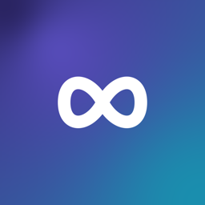
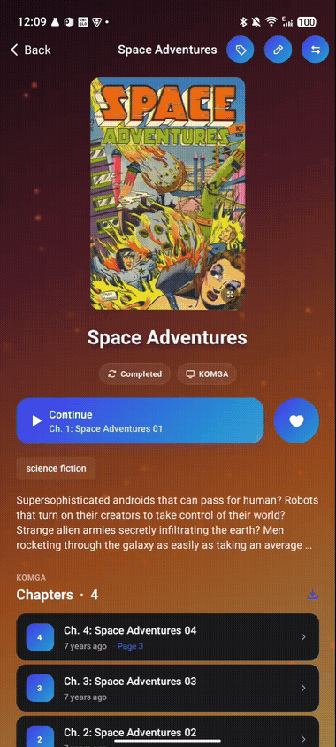
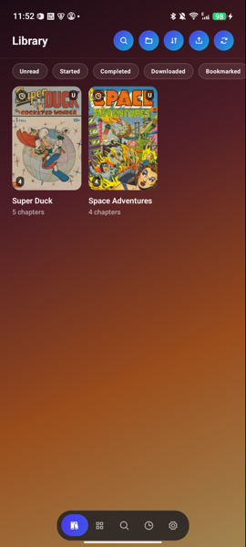
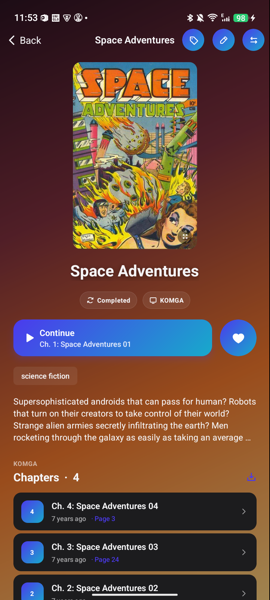
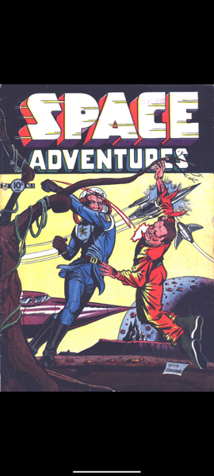
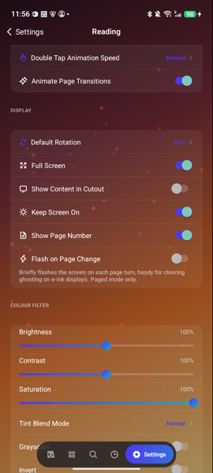
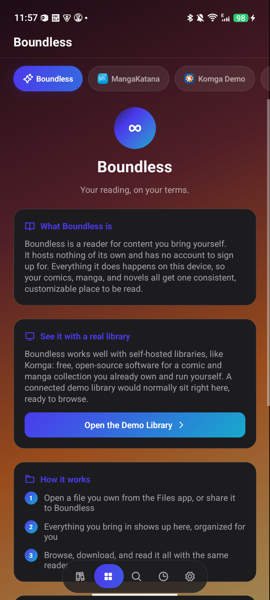
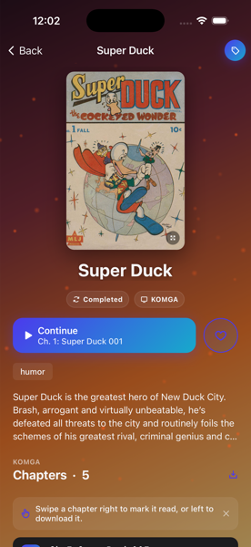
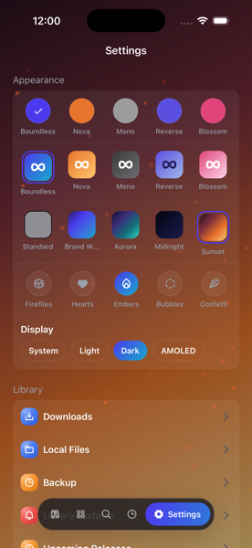
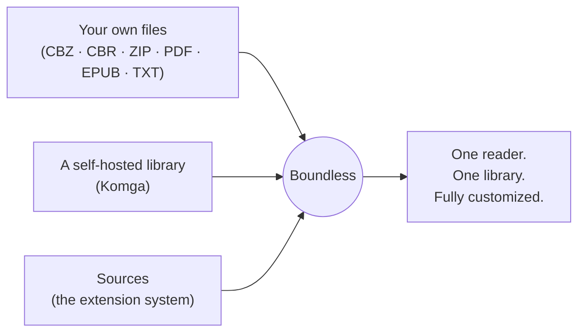

# Boundless

**Your reading, on your terms.**

A reader for manga, manhwa, webtoons, and novels that hosts nothing of its own.
It runs entirely on your device, and it never requires an account.

&nbsp;

Always the latest build. No sign-up, no Play Store account, no tracking.

 

 

## Why Boundless

Most readers ask you to trust a server somewhere, or a company's app store review process, with a library you built yourself. Boundless doesn't. Everything, your files, your progress, your settings, stays on your device unless you explicitly choose to sync it. There's nothing to sign up for to start reading, and nothing phoning home in the background.

<table>
<tr>
<td width="33%" valign="top">

### 📖 Read anything
CBZ, CBR, ZIP, PDF, EPUB, and TXT out of the box. Connect a self-hosted Komga library, or add sources through the extension system.

</td>
<td width="33%" valign="top">

### 🎨 Tuned to you
Reading mode, page scaling, border cropping (with an automatic per-page mode), color filters, tap zones, fonts, margins. Every option, for comics and novels separately.

</td>
<td width="33%" valign="top">

### 🔌 Works offline
A real reading cache keeps chapters you've opened available with no connection, with a size limit you control. Downloads keep chapters forever until you delete them.

</td>
</tr>
<tr>
<td width="33%" valign="top">

### 🔄 Sync when you want it
An optional free account keeps your library, progress, and categories in sync across devices. Skip it entirely and everything still works, offline-first by design.

</td>
<td width="33%" valign="top">

### 📊 Tracker integration
Link AniList, Kitsu, MyAnimeList, MangaUpdates, Shikimori, or Bangumi, and your progress pushes automatically as you read.

</td>
<td width="33%" valign="top">

### 🔒 Built for every reader
Content rating controls, parental controls with reading-hour limits, and an app lock with PIN or biometrics.

</td>
</tr>
</table>

## Screenshots

<table>
<tr>
<td align="center" width="25%"> <b>Library</b></td>
<td align="center" width="25%"> <b>Title detail</b></td>
<td align="center" width="25%"> <b>Distraction-free reader</b></td>
<td align="center" width="25%"> <b>Deep customization</b></td>
</tr>
</table>

<b>More screenshots</b> (sources, and the iOS build)

 

<table>
<tr>
<td align="center" width="25%"> <b>Android: sources</b></td>
<td align="center" width="25%"> <b>iOS: title detail</b></td>
<td align="center" width="25%"> <b>iOS: reader</b></td>
<td align="center" width="25%"> <b>iOS: settings</b></td>
</tr>
</table>

## How it works

Nothing is bundled or hosted by the app itself. You point Boundless at content you already have the rights to, and it takes care of organizing, caching, and presenting it consistently.

## Download

**Android.** Download the APK above, or grab it directly from the [latest release](https://github.com/realwuji/boundless-public/releases/latest). Requires Android 7.0 or newer. It's release-signed and distributed outside the Play Store, so Android will ask for a one-time permission to install from your browser or file manager the first time, the same prompt any app outside the Play Store shows.

Updating works the same way: install the newer APK over the existing one. Since every release is signed with the same key, your library, settings, and reading progress stay exactly where you left them.

**iOS.** Available on the [App Store](https://apps.apple.com/app/id6804857456).

## Getting started

New to Boundless? The [getting started guide](docs/getting-started.md) walks through adding your first titles, the reader, offline reading, sync, and the settings most worth knowing about.

## Links

- Website: [boundless.moe](https://boundless.moe)
- Privacy policy: [boundless.moe/privacy](https://boundless.moe/privacy)
- Terms: [boundless.moe/terms](https://boundless.moe/terms)
- Release notes: [CHANGELOG.md](CHANGELOG.md)

---

This repository holds public documentation and Android release builds only. The app's source code is not published here. The "Source code" archives GitHub attaches to each release below are an automatic snapshot of this documentation repository, not the app.
